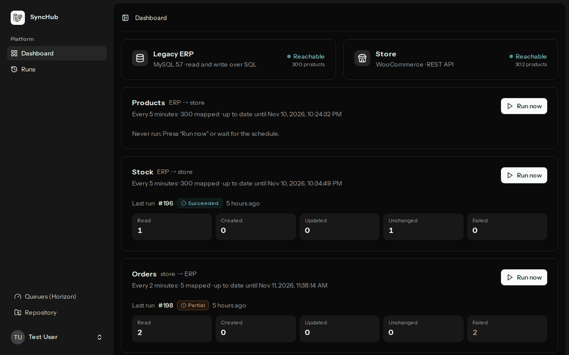
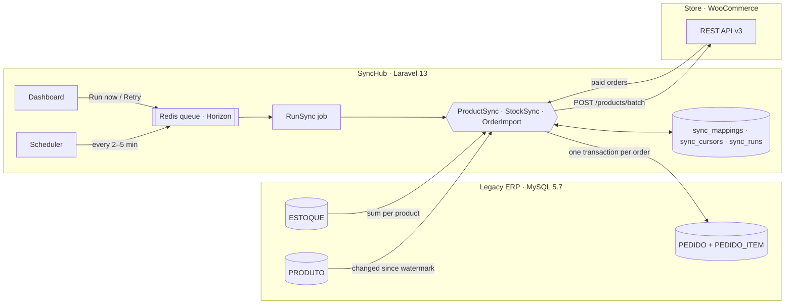
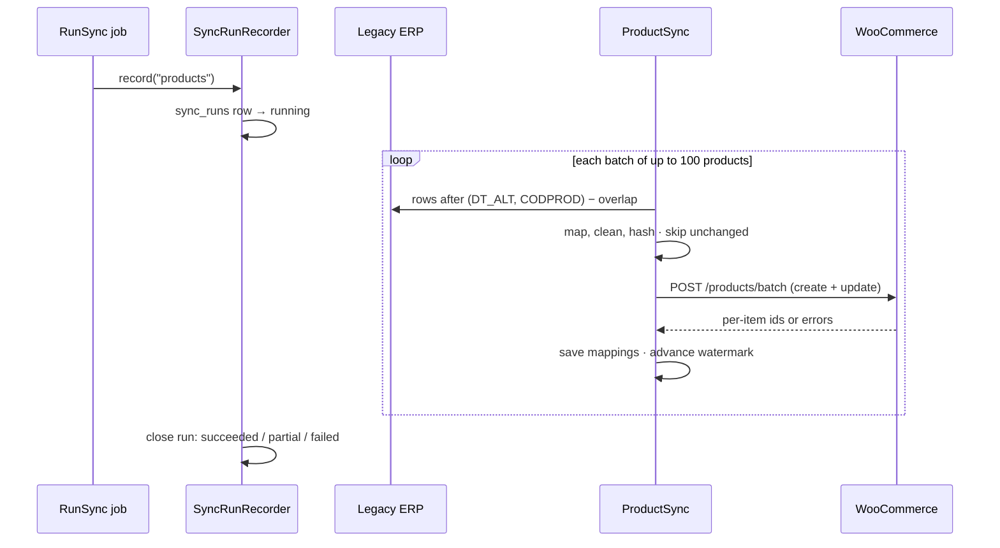
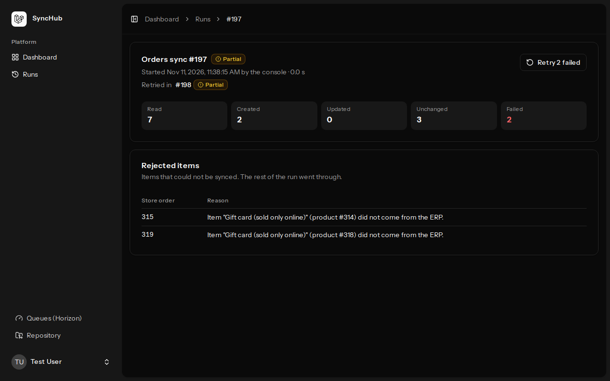

# SyncHub

[](https://github.com/guilh-000/synchub/actions/workflows/tests.yml)

Keeps a **legacy ERP** and an **online store** in sync: products, prices and
stock flow from the ERP to the store, and paid orders flow back into the ERP.

It is built around the problems real integrations run into: a schema nobody
can change, no "changed since" API, flaky networks, duplicated orders, and the
need to know exactly what failed — and replay it.



## Highlights

- **Incremental and idempotent.** Each sync reads only what changed since its
  watermark, never creates a record twice, and skips what did not change.
- **Batched, retried, resumable.** Up to 100 products per request, retries with
  backoff on network errors, 429 and 5xx, and a watermark that only moves after
  the store accepts a batch.
- **Never the same order twice** — even if SyncHub dies between writing to the
  ERP and saving its own mapping.
- **Every run on record**: counters, duration, the error that stopped it and
  each rejected item with its reason, plus a **Retry** button for just those.
- **Real legacy data**: latin1 tables, all-caps names, negative stock,
  inactive products, no unique keys — all in a reproducible Docker stack.
- 90+ Pest tests, Larastan level 7 and the same checks on every push.

## Architecture



One product run, step by step:



## Stack

Laravel 13 · PHP 8.5 · Inertia + React 19 · Tailwind + shadcn/ui ·
MySQL 8.4 · Redis + Horizon · Pest · Larastan · Docker Compose · GitHub Actions

## Running locally

Requirements: Docker. Nothing else is installed on the host — Composer and npm
run inside the containers.

```bash
cp .env.example .env
docker compose build
docker compose run --rm --no-deps app composer install
docker compose run --rm --no-deps app php artisan key:generate
docker compose run --rm --no-deps vite npm ci
docker compose up -d
docker compose exec app php artisan migrate --seed
```

Log in with `test@example.com` / `password` (created by the seeder), then:

```bash
docker compose exec app php artisan sync:run products     # 300 products into the store
docker compose exec app php artisan sync:run stock
docker compose exec app php artisan demo:place-orders 3 --foreign
docker compose exec app php artisan sync:run orders       # 3 orders into the ERP, 1 rejected
```

The scheduler keeps running the three syncs afterwards.

| Service                  | URL                                                |
| ------------------------ | -------------------------------------------------- |
| SyncHub                  | http://localhost:8100                              |
| Horizon (queues)         | http://localhost:8100/horizon                      |
| Demo store (WooCommerce) | http://localhost:8180/wp-admin — `admin` / `admin` |

The first `up` installs WordPress + WooCommerce and writes the store's API
credentials to `storage/app/private/woocommerce.json` (container `shop-init`).

## What runs in the stack

| Container                             | Role                                                                    |
| ------------------------------------- | ----------------------------------------------------------------------- |
| `app`, `horizon`, `scheduler`, `vite` | SyncHub: web, queue workers, scheduled syncs, assets                    |
| `mysql`                               | SyncHub's own database                                                  |
| `legacy-erp`                          | A fake legacy ERP: MySQL 5.7, latin1, uppercase tables, no foreign keys |
| `redis`                               | Queues and cache                                                        |
| `shop`, `shop-db`, `shop-init`        | WordPress + WooCommerce demo store                                      |

### The legacy ERP

[`docker/legacy-erp`](docker/legacy-erp) creates 300 products across two
warehouses, plus the quirks real legacy data has: inactive products that must
be hidden (never deleted), descriptions with trailing spaces and shouting
case, missing weights, negative stock, and an orders table with no unique key
on the external order number.

The only change signal is a `DT_ALT` timestamp column — which is what the
incremental sync will rely on.

## The syncs

| Sync       | Direction   | Schedule    | What it does                                |
| ---------- | ----------- | ----------- | ------------------------------------------- |
| `products` | ERP → store | every 5 min | name, SKU, price, weight, published/draft   |
| `stock`    | ERP → store | every 5 min | total of all warehouses, never below zero   |
| `orders`   | store → ERP | every 2 min | paid orders become `PEDIDO` + `PEDIDO_ITEM` |

```bash
docker compose exec app php artisan sync:run products          # run now, print counters
docker compose exec app php artisan sync:run stock --full      # ignore the watermark
docker compose exec app php artisan sync:run orders --queue    # hand it to Horizon
docker compose exec app php artisan demo:place-orders 3 --foreign   # demo orders in the store
```

On a fresh stack run `products`, then `stock`: stock only goes to products the
store already has. `demo:place-orders` places paid orders (with `--foreign`,
also one with a product that never came from the ERP, to see a rejection).

Each sync implements the same small contract (`App\Sync\Sync`: `run()` and
`retry()`), is listed in `config/synchub.php` and runs through one queued job,
`RunSync`, unique per sync.

### Design decisions

**Watermark instead of full scans.** The ERP only has a `DT_ALT` timestamp.
Rows are read in `(DT_ALT, CODPROD)` order and paged by that pair (keyset
pagination), so thousands of rows sharing one timestamp never break paging.
The position is saved in `sync_cursors`.

**An overlap window, so nothing is lost.** `DT_ALT` has one-second precision:
a row updated in the same second as the last row read, but with a lower code,
would be skipped by a strict "after the watermark" query. Each run rereads the
last few seconds (`SYNC_PRODUCTS_OVERLAP_SECONDS`); what did not change is
skipped by its hash, so the overlap costs reads, not API calls.

**A mapping table makes the sync idempotent.** `sync_mappings` links each ERP
code to the store's product ID. Running twice updates instead of duplicating,
and a product whose SKU already exists in the store (created by hand, or a lost
mapping) is adopted rather than rejected.

**Hash of the payload, not of the row.** Rows are touched without real changes
all the time. The SHA-256 of what would be sent is compared with the last one
sent; equal means no request.

**Batches, retries and a watermark that only moves forward on success.** Up to
100 products go in one `/products/batch` request. Network errors, 429 and 5xx
are retried with growing delays (0.5 s, 2 s, 5 s); the job itself retries after
1 and 5 minutes. The watermark only advances after the store accepts a batch,
so a run that dies resumes where it stopped. One rejected product is reported
and does not block the others.

**Clean legacy data on the way.** Names typed in all caps become sentence case,
extra spaces go away, missing weights are left out, and inactive products are
set to _draft_ — hidden, never deleted, so the store keeps their history.

**Encoding.** The ERP's tables are latin1; the connection asks MySQL for
utf8mb4 so PHP only ever sees UTF-8. Without it, names like _Rolamento rígido_
break JSON encoding — the hash uses `JSON_THROW_ON_ERROR` so that kind of
problem fails loudly instead of sending a broken product.

### Stock sync

`ESTOQUE` has one row per product and warehouse; the store has one number.
Rows are grouped per product (`SUM(QTD)`, `MAX(DT_ALT)`) and paged by that
change time, so moving units between warehouses re-reads the product but
sends nothing when the total did not change. Negative ERP stock is sent as 0.
Stock for a product the store does not have yet is reported, not lost: replay
it once the product sync has run.

### Order import

Paid orders (`processing`, `completed`) are read by modification date and
written to the ERP, header and items in **one transaction** — the ERP never
sees half an order. An order is never written twice:

1. a mapping row links the store order to the ERP `NUMPED`;
2. before writing, the ERP is searched for the store order number too. The
   ERP has no unique key on it, and the mapping lives in another database,
   saved after the ERP commit: if SyncHub dies between the two, the next run
   finds the order in the ERP and only restores the mapping.

An order with a product that did not come from the ERP is not written at all
and is reported with the reason.

### Replaying failures

Every rejected item is stored with its reason. **Retry** on a run queues a new
run of the same sync with only those items (`Sync::retry()`), whatever the
watermark says; the two runs link to each other.

## Dashboard

- **Health** of both systems — loaded as a deferred prop after the page
  renders, so a slow or broken store never blocks the dashboard.
- One card per sync: schedule, watermark, mapped records, last run and a
  **Run now** button (queued; refused while that sync is running).
- **Runs**: every execution with who started it (schedule, dashboard,
  console), its counters, duration, the error that stopped it and the items
  the store rejected, with a **Retry** button. Pages poll while a run is in
  progress.

Each run is a `sync_runs` row created as _running_ before any work starts and
closed by `SyncRunRecorder`, so a run that dies halfway still shows what it did
and why it stopped.



## Where to look in the code

| Path                                                           | What is there                                                           |
| -------------------------------------------------------------- | ----------------------------------------------------------------------- |
| [`app/Sync`](app/Sync)                                         | The `Sync` contract, the registry, the run recorder and the three syncs |
| [`app/Integrations/LegacyErp`](app/Integrations/LegacyErp)     | Readers and the order writer for the legacy ERP                         |
| [`app/Integrations/WooCommerce`](app/Integrations/WooCommerce) | REST client: batching, retries, per-item results                        |
| [`app/Jobs/RunSync.php`](app/Jobs/RunSync.php)                 | The one queued job every sync runs through                              |
| [`tests/Feature/Sync`](tests/Feature/Sync)                     | Behaviour of each sync, against an in-memory ERP and a fake store       |
| [`docker/legacy-erp`](docker/legacy-erp)                       | The fake ERP's schema and data                                          |

## Quality checks

```bash
docker compose exec app composer ci:check
```

Runs formatting and lint (Pint, Vite+), static analysis (Larastan level 7)
and the Pest suite. The same command runs on every push in GitHub Actions.
